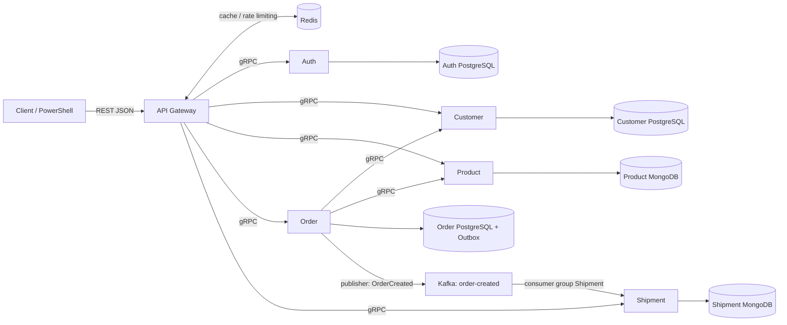

# Kế hoạch Backend E-Commerce MVP

Ngày phân tích: 27/10/2026. Môi trường mục tiêu: Windows, PowerShell, Docker Desktop, Codex App.

**Trạng thái cập nhật 27/10/2026: đã triển khai và kiểm thử sáu giai đoạn trong phạm vi MVP theo quyền tự quyết chỉnh sửa người dùng đã giao.** Đã chạy 25/25 TC nguồn, 17 test cô lập, 8 kiểm tra System, 7 kiểm tra Resilience, outage Kafka và SIGKILL/restart Order. Tiêu chí kế hoạch ở mục 7 được giữ để đối chiếu; kết quả thực tế và giới hạn kiểm thử nằm trong `IMPLEMENTATION-REPORT.md`, không suy ra PASS chỉ từ lệnh dự kiến.

## 1. Tài liệu đã đọc

Repository có `doc/`; không có `docs/`. Không đổi tên thư mục nguồn.

| Mã nguồn | Tệp trong `doc/` | Phạm vi đã đọc và vai trò |
|---|---|---|
| S1 | `3. Prompt_microservice.doc` | Toàn bộ nội dung yêu cầu chính: Node.js, Microservices, DDD, Database-per-Service, từng bước có kiểm tra, Gateway, Redis cache/rate limiting, Docker và nghiệp vụ MVP. |
| S2 | `Customer-Requirement.doc` | Toàn bộ yêu cầu khách hàng: xem sản phẩm, đặt hàng, giảm giá theo điểm, cập nhật tồn kho, chuyển giao hàng và xem trạng thái. |
| S3 | `Functional_Requirements_Ecommerce_MVP.xlsx` | Sheet `Functional Requirements`, A1:C14, đủ FR01–FR13. |
| S4 | `Use_Cases_Ecommerce_MVP.xlsx` | Sheet `Use Cases`, A1:J14, đủ UC01–UC13, gồm exception flow và Outbox. |
| S5 | `API_Specification_Ecommerce_MVP.xlsx` | Sheet `API Specification`, A1:K16, đủ 15 API, auth, request/response và status. |
| S6 | `Customer_Business_Functional_Requirements_Traceability.xlsx` | Ba sheet `Customer Requirements`, `Business Requirements`, `Requirements Traceability`; mỗi sheet 7 dòng dữ liệu, đủ CR01–07/BR01–07 và mapping. |
| S7 | `25_TestCases_5_BoundedContexts.xlsx` | Sheet `25 Test Cases`, A1:E26, đủ 25 TC thuộc 5 context. |
| S8 | `Bounded-Context.jpg` | Đủ 5 context, entity, thuộc tính, ownership và quan hệ nội bộ. |
| S9 | `ERD.jpg` | Toàn bộ ERD tổng thể; đối chiếu với ownership của S8. |
| S10 | `Business-Process-Model.png` | Đủ 10 bước, sequence, gRPC, DB Transaction + Outbox, Kafka và Shipment PENDING. |
| S11 | `Microservice-Architecture-Design.jpg` | Toàn bộ Gateway, 5 service, DB riêng, Redis, gRPC, Kafka topic `order-created`. |
| S12 | `PhieuChamThucHanh.png` | Đủ 8 dòng chấm, mỗi dòng Max = 1; tổng các dòng là 8. |

Không có tệp nào chưa đọc được. Hai `.doc` là Word binary OLE; đã trích theo FIB/CLX piece table, đối chiếu lần lượt 1.094/1.094 và 760/760 ký tự với độ dài main story. Không có story footnote/header/comment/textbox chứa văn bản. Đã đọc đủ 5 workbook, 7 sheet; không có sheet ẩn, công thức, comment hoặc drawing trong các workbook. Năm ảnh đã xem ở độ phân giải gốc. Đây là kiểm tra nội dung nguồn, không phải kiểm thử ứng dụng.

S1 và chỉ dẫn người dùng xác định phạm vi; S12 xác định ưu tiên trình diễn. Các nguồn chi tiết bổ sung lẫn nhau. Khi bất nhất, giữ nguyên nguồn, ghi quyết định trong mục 6; không tự xóa yêu cầu chỉ vì nguồn khác không nhắc đến.

## 2. Tổng hợp và đối chiếu yêu cầu

### 2.1 Phạm vi chức năng

| Yêu cầu | Nguồn đối chiếu | Phần triển khai và bằng chứng cần có |
|---|---|---|
| FR01 đăng ký; FR02 đăng nhập | S1; S3 dòng 2–3; UC01/02; API-AUTH-01/02; TC-IAM-01–05 | User lưu Auth PostgreSQL, bcrypt, username/email uniqueness theo chính sách đã chốt, JWT thật có sub/role. |
| FR03 thông tin cá nhân; FR04 Customer/Membership | S1; S3 dòng 4–5; UC03/07; API-CUS-01/02; TC-CUS-01–05 | Customer và Membership trong Customer PostgreSQL; xem/cập nhật đúng quyền, lấy mname/score qua mid. |
| FR05 quản trị Product; FR06 xem Product | S3 dòng 6–7; UC04/05; API-PRO-01–05; TC-PRO-01–05 | CRUD Product trong MongoDB; đọc có JWT; ghi cần Admin; tồn kho lấy từ DB. |
| FR07 đặt hàng; FR08 discount | S1/S2; S3 dòng 8–9; UC06/07/09; API-ORD-01; TC-ORD-01–05 | Lấy score và giá từ service sở hữu; tính discount bằng chính sách đã xác nhận; lưu Order + chi tiết + Outbox. |
| FR09 cập nhật tồn kho | S2; S3 dòng 10; UC08; TC-PRO-05/TC-ORD-03 | Giảm kho có điều kiện, không âm; có bù trừ và phục hồi khi Order thất bại. |
| FR10 lưu/xem Order | S3 dòng 11; UC09/10; API-ORD-01–03 | Order/OrderDetail PostgreSQL, snapshot unit_price, chỉ người sở hữu/Admin được phép xem. |
| FR11 giao hàng; FR12 xem trạng thái | S1/S2; S3 dòng 12–13; UC11/12; API-SHP-01/02; TC-SHP-01–05 | Consumer Kafka tạo Shipment, chống trùng event, cập nhật status đúng quyền, đọc từ MongoDB. |
| FR13 phân quyền | S3 dòng 14; UC13; auth trong S5 | 401 khi thiếu/sai token, 403 khi thiếu quyền; Customer/Admin/Shipment Staff và ownership. |
| Gateway, Redis, health, vận hành | S1; S5 API-HEALTH-01; S11/S12 | Routing, JWT, authorization, logging, cache, rate limiting, health thực và Docker Compose. |

S6 chỉ nối CR/BR đến FR01, FR02, FR03, FR06, FR07, FR08, FR12; chưa phủ FR04/05/09/10/11/13 và chưa có cột TC. Các chức năng chưa được mapping vẫn thuộc MVP vì đã có trong S3/S4/S5. UC09 liên kết FR07 trong Excel; khi lập trace thực thi cần bổ sung FR10, không sửa nguồn.

### 2.2 API có trong nguồn

Các route, role và status dưới lấy từ S5, sheet `API Specification`, bổ sung quyền Order/Shipment từ UC10/12 khi ghi rõ. Kiểm tra ownership Customer là đề xuất bảo mật từ việc UC03 quản lý thông tin cá nhân, cần chốt D14. JSON ví dụ trong nguồn là hình dạng minh họa, không phải dữ liệu bắt buộc phải hardcode.

| API / dòng | Method và route | Quyền | Kết quả chính |
|---|---|---|---|
| API-AUTH-01 / 2 | POST `/api/auth/register` | Không JWT | 201 và uid; 400 dữ liệu lỗi; 409 trùng username/email. |
| API-AUTH-02 / 3 | POST `/api/auth/login` | Không JWT | 200 accessToken/tokenType/expiresIn; 400 thiếu dữ liệu; 401 sai thông tin. |
| API-CUS-01 / 4 | GET `/api/customers/:uid` | JWT, kiểm tra ownership | 200 uid/fullname/mid; 401/404. |
| API-CUS-02 / 5 | PUT `/api/customers/:uid` | JWT, authorized user/Admin | 200 cập nhật; 400/401/404; quyền sửa mid cần chốt. |
| API-PRO-01 / 6 | GET `/api/products` | JWT | 200 `{items:[...]}`; 401. |
| API-PRO-02 / 7 | GET `/api/products/:pid` | JWT | 200 chi tiết; 401/404. |
| API-PRO-03 / 8 | POST `/api/products` | Admin | 201; 400/401/403. |
| API-PRO-04 / 9 | PUT `/api/products/:pid` | Admin | 200; 400/401/403/404. |
| API-PRO-05 / 10 | DELETE `/api/products/:pid` | Admin | 200; 401/403/404. |
| API-ORD-01 / 11 | POST `/api/orders` | JWT | Body chỉ items(pid,qty); 201; 400/401/404/409. |
| API-ORD-02 / 12 | GET `/api/orders` | JWT | 200 danh sách Order của chủ thể hiện tại. |
| API-ORD-03 / 13 | GET `/api/orders/:oid` | JWT, owner/Admin | 200 Order và details; 401/404; UC10 bổ sung 403. |
| API-SHP-01 / 14 | GET `/api/shipments/:shipid` | JWT, kiểm tra ownership | 200 shipid/oid/status; 401/404; UC12 bổ sung 403. |
| API-SHP-02 / 15 | PATCH `/api/shipments/:shipid/status` | Shipment Staff/Admin | Body status; 200; 400/401/403/404. |
| API-HEALTH-01 / 16 | GET `/api/health` | Không JWT | 200 UP hoặc 503 nếu dependency bắt buộc unhealthy. |

**Bổ sung đề xuất để đáp ứng TC-CUS-04:** GET `/api/customers/:uid/membership`, JWT và owner/Admin, trả `{mid,mname,score}` từ Customer DB, 200/401/403/404. Endpoint này chưa có trong S5; cần chốt contract ở giai đoạn 1. Không cần tạo discount API riêng vì UC07 và S5 đặt việc tính discount trong POST Order.

### 2.3 Ngoài phạm vi

Không thêm frontend, payment, cart service, coupon/promotion, notification, Kubernetes, event sourcing, hệ thống tracking chi tiết hoặc quy trình hủy Order/hoàn tiền. Các bổ sung Outbox, chống lặp và phục hồi tồn kho là kỹ thuật cần để đáp ứng UC06/09 và TC-SHP-05, không phải tính năng kinh doanh mới.

## 3. Kiến trúc đề xuất theo thiết kế

### 3.1 Service và database

| Thành phần | Ownership / nhiệm vụ | Lưu trữ riêng |
|---|---|---|
| API Gateway | REST, auth/JWT, authorization, routing gRPC, cache, rate limiting, logging | Redis, không chứa dữ liệu nghiệp vụ gốc. |
| Auth Service | User(uid,username,password hash,roleid), Role(roleid,rolename); email/phone theo API và quyết định D06 | PostgreSQL `auth-db`. |
| Customer Service | Customer(uid,fullname,mid), Membership(mid,mname,score) | PostgreSQL `customer-db`. |
| Product Service | Product(pid,pname,price,quantity); kiểm tra/cập nhật tồn kho | MongoDB `product-db`. |
| Order Service | Order(oid,uid,discount), OrderDetail(oid,pid,qty,unit_price), OutboxEvent; điều phối đặt hàng | PostgreSQL `order-db`. |
| Shipment Service | Shipment(shipid,oid,status); nhận OrderCreated, cập nhật trạng thái | MongoDB `shipment-db`. |
| Kafka | Lưu và phân phối OrderCreated, consumer group của Shipment | Broker riêng, topic `order-created`. |

Ownership vật lý theo S8/S11: Auth không sở hữu fullname/mid; Customer sở hữu các trường này. `uid` của Customer dùng cùng định danh Auth, không tạo FK sang Auth DB. `uid`/`pid` trong Order và `oid` trong Shipment cũng là tham chiếu logic. Chỉ FK trong cùng database, chẳng hạn OrderDetail→Order và Customer→Membership.

S8 đặt `score` trên Membership, không phải một số dư điểm cá nhân trong Customer. Kế hoạch giữ mô hình này; chưa thêm cơ chế cộng/trừ/tích lũy điểm sau mua hàng. Inventory/Tracking được S11 nhắc đến nhưng không có schema riêng trong S8/S9; quantity và status hiện đáp ứng phần nghiệp vụ đã định nghĩa.

**Topology Compose đề xuất:** 6 container ứng dụng + 3 PostgreSQL + 2 MongoDB + Redis + Kafka = **13 container chạy thường trực**. Mỗi DB có volume và credential riêng. Migration/seed/init topic hoặc replica set là one-off job, liệt kê riêng nếu xuất hiện. S12 không ấn định số container; con số 13 là lựa chọn triển khai để thể hiện ownership rõ cho sinh viên.

Kafka đề xuất một broker KRaft cho local, không thêm ZooKeeper/Kafka UI mặc định; đây là lựa chọn kỹ thuật, không phải chi tiết bắt buộc trong hình. Product MongoDB có thể cần single-node replica set cho transaction tồn kho; chốt ở giai đoạn 1, vẫn một container Product DB. Không suy diễn local một broker là kiến trúc HA.

### 3.2 Giao tiếp



- Gateway là cổng HTTP duy nhất publish ra host; các cổng gRPC/DB/broker dùng mạng Compose nội bộ, có thể mở cổng debug qua cấu hình riêng khi cần.
- Đề xuất Gateway kiểm tra JWT qua Auth gRPC khi cache miss; cache kết quả xác thực theo fingerprint token, TTL không vượt expiry, kiểm tra expiry cả khi cache hit. Redis còn thực hiện rate limiting nguyên tử theo cấu hình. Không cần thêm logout/session flow vào MVP.
- Gateway truyền danh tính đã xác thực qua metadata; service kiểm tra quyền và ownership. Không tin header danh tính tùy ý từ client.
- Order là nơi điều phối Customer/Membership, Product và tính discount. Không để Gateway chứa nghiệp vụ Order hoặc truy cập database trực tiếp.
- gRPC có deadline, mapping lỗi thống nhất: INVALID_ARGUMENT→400, UNAUTHENTICATED→401, PERMISSION_DENIED→403, NOT_FOUND→404, lỗi thiếu tồn kho→409, UNAVAILABLE→503, DEADLINE_EXCEEDED→504. Đây là contract đề xuất; lỗi tồn kho phải có mã nghiệp vụ để phân biệt với lỗi precondition khác.
- Không retry mù một RPC ghi. Retry cập nhật kho/phát lại event phải có định danh chống lặp.
- Hình S11 ghi HTTPS. Đề xuất HTTP cho localhost trong bài thực hành; HTTPS/TLS ngoài local cần quyết định riêng, không gọi HTTP local là đã đáp ứng TLS production.

### 3.3 Cấu trúc dự kiến và Proto

```text
AGENTS.md
PLAN.md
README.md                         # sẽ tạo khi triển khai
compose.yaml
.env.example
package.json / package-lock.json  # workspace Node.js, chốt ở giai đoạn 1
proto/
  auth.proto
  customer.proto
  product.proto
  order.proto
  shipment.proto
services/
  api-gateway/src/                # routes, middleware, gRPC clients, Redis
  auth-service/src/{domain,application,infrastructure,interfaces}/
  customer-service/src/{domain,application,infrastructure,interfaces}/
  product-service/src/{domain,application,infrastructure,interfaces}/
  order-service/src/{domain,application,infrastructure,interfaces}/
  shipment-service/src/{domain,application,infrastructure,interfaces}/
infra/                            # DB init/migrations theo owner, Kafka init
scripts/                          # PowerShell: seed, kiểm thử, demo
tests/                            # domain/integration theo giai đoạn
```

Đây là cây dự kiến; hiện chưa tạo các thư mục triển khai. Đề xuất JavaScript ESM, REST framework mỏng ở Gateway, Node gRPC và driver DB/client Kafka tương thích; chốt phiên bản có kiểm tra ở giai đoạn 1. Không đưa framework nặng vào domain.

Mỗi proto khai báo `package`, `service`, RPC, request/response message, field number và kiểu dữ liệu; giải thích ID dùng chung ở ranh giới service và lỗi gRPC. Các RPC dự kiến:

| Proto | Contract nghiệp vụ cần có |
|---|---|
| auth | Register, Login, VerifyToken. |
| customer | GetCustomer, UpdateCustomer, GetMembership; EnsureCustomer nội bộ nếu chốt provisioning. |
| product | List/Get/Create/Update/DeleteProduct; kiểm tra/cập nhật tồn kho idempotent và bù trừ. |
| order | CreateOrder, ListOrders, GetOrder. |
| shipment | GetShipment, UpdateShipmentStatus; tra cứu theo Order nếu chốt D03. |

Tất cả service có health gRPC thực. Tiền truyền qua gRPC bằng representation decimal thống nhất, không dùng float để tính. Giữ ID nghiệp vụ dạng số nguyên theo S8/S9 và mẫu API; chính sách sinh ID cho MongoDB phải được chốt, không trả `_id` thay `pid/shipid`.

### 3.4 Luồng đặt hàng, transaction và sự kiện

1. Client có JWT gửi POST `/api/orders` với `{"items":[{"pid":1,"qty":2}]}`. `pid=1` chỉ là ví dụ; test lấy ID fixture thực. Validate qty nguyên dương, danh sách không rỗng và quy tắc pid lặp đã chốt.
2. Gateway xác thực, áp quyền/rate limit rồi gọi Order bằng gRPC. Order lấy uid từ danh tính tin cậy; không nhận uid/discount/unit_price từ body làm dữ liệu có thẩm quyền.
3. Order lấy Customer và Membership qua Customer gRPC. Không có Customer→404; không lấy được Membership thì dừng an toàn, không tự coi score bằng 0.
4. Order xác minh policy và dữ liệu đầu vào trước side effect; lấy giá Product, tính discount từ score và bảng chính sách đã xác nhận, rồi kiểm tra/giảm kho bằng thao tác nguyên tử có operationId. Product trả price snapshot của operation; nếu giá đổi so với lần đọc, phải tính lại theo snapshot trước final commit, lỗi thì bù kho. Không tách read-stock rồi update vô điều kiện.
5. Order ghi Order, OrderDetail, OutboxEvent trong **cùng transaction PostgreSQL**. Có lỗi thì rollback cả ba. Cập nhật trạng thái điều phối tương ứng trong cùng transaction để recovery phân biệt commit thật với commit chưa rõ kết quả.
6. Publisher nền đọc outbox đã commit, gửi Kafka, chờ acknowledgement rồi đánh dấu đã gửi. Kafka lỗi sau commit: Order vẫn đã lưu; outbox pending/retry. Không trả lỗi giả rằng Order chưa tạo rồi khuyến khích client tạo trùng.
7. Shipment consumer validate event, tạo Shipment PENDING và ghi receipt eventId nguyên tử trước commit offset. Event gửi lại không tạo Shipment trùng. Event thiếu oid không tạo Shipment và phải được ghi nhận lỗi; lỗi hạ tầng tạm thời phải retry, không nuốt lỗi.
8. Response 201 phản ánh Order đã commit; Shipment tạo sau. Dùng polling có timeout để quan sát Kafka và Shipment; không bịa shipid để khớp response mẫu.

**Bảo vệ tồn kho xuyên database — đề xuất kỹ thuật cần hoàn tất ở giai đoạn 4:** local Order transaction và Outbox không tự rollback MongoDB. Ghi operationId/trạng thái điều phối bền vững trước cập nhật kho; Product ghi receipt và thay đổi kho nguyên tử, retry cùng operationId không trừ lại, cùng ID nhưng payload khác phải bị từ chối. Có thể dùng MongoDB transaction trong single-node replica set để cập nhật nhiều Product và receipt cùng lúc. Khi Order thất bại, bù kho idempotent; khi service chết, worker phục hồi đọc trạng thái bền vững, kiểm tra Order đã commit trước quyết định bù. Có lease/khóa trạng thái để recovery không tranh chấp request còn chạy. Không chỉ dùng `try/catch` trong RAM. Không đặt timeout rồi tự hoàn kho khi chưa biết Order có commit hay không.

Protocol tối thiểu đề xuất gồm bảng `order_attempts` tại Order, collection `inventory_operations` tại Product, RPC nội bộ ApplyInventory/GetInventoryOperation/CancelInventory và một vòng recovery trong Order. Final transaction PostgreSQL phải khóa/kiểm tra attempt còn cho phép commit, rồi đổi attempt thành COMMITTED cùng Order/details/outbox. Recovery muốn hủy phải chuyển trạng thái bền vững sang ABORTING trước khi bù; worker cũ không được tạo Order sau trạng thái đó. Product ghi dấu CANCELLED ngay cả khi chưa thấy Apply, để RPC Apply đến muộn không trừ kho sau lần hủy. Các trạng thái này là kỹ thuật nội bộ, không phải state machine Order mới cho người dùng.

Đây là protocol kỹ thuật cho UC06 exception flow, không thêm chức năng saga cho người dùng. Nếu implementation chưa xử lý được crash/partial failure, phải ghi rõ giới hạn và chưa đánh dấu tiêu chí nhất quán hoàn tất.

**Event contract đề xuất:** envelope `eventId`, `eventType=OrderCreated`, `eventVersion`, `occurredAt`; payload `oid`, `uid`, các item `pid/qty/unit_price`, `discount` và tổng tiền theo contract đã chốt. Topic chính xác `order-created`, key đề xuất là oid. Consumer group Shipment riêng; consumer kiểm thử dùng group riêng để không lấy mất message của Shipment. Không chứa password/JWT.

Chống lặp dựa eventId; ERD cho Order→0..* Shipment nên không tự thêm unique(oid). Có thể lưu eventId ngay trên document Shipment với unique index, để một lần insert đồng thời lưu kết quả và receipt. Schema cần đủ uid hoặc phương thức xác minh ownership qua Order gRPC; phải chốt trước Shipment API.

## 4. Điều kiện và chứng cứ cho 8 mục chấm

Nguồn S12 chỉ ghi tên 8 mục, mỗi mục Max=1; không ghi payload, điểm thành viên hay số lượng container cụ thể. Các điều kiện dưới kết hợp S4/S5/S7/S8/S11 và yêu cầu trực tiếp dùng hạ tầng thật của người dùng. Các bổ sung kỹ thuật được ghi là đề xuất.

### Mục 1 — Giải thích Proto và cấu trúc dự án

- Đầu vào: source đã triển khai, đủ 5 proto và các layer DDD, contract đã được kiểm tra load.
- Thao tác dự kiến: `Get-ChildItem .\proto\*.proto`; mở một RPC Order và các RPC Customer/Product mà nó gọi; chỉ ra domain/application/infrastructure/interfaces và database owner.
- Kết quả cần chứng minh: request/response, field number, kiểu dữ liệu, lỗi và synchronous gRPC khác với asynchronous Kafka; một RPC thực trả dữ liệu qua Gateway. Không chỉ trình bày cây thư mục.

### Mục 2 — Compose và container theo thiết kế

- Đầu vào: Docker Desktop Linux Engine hoạt động, `.env` hợp lệ, images/build context, health check, DB init/migration sẵn sàng.
- Lệnh dự kiến: `docker compose config`; `docker compose up -d --build --wait`; `docker compose ps --all`; `Invoke-RestMethod http://localhost:3000/api/health` (cổng 3000 là đề xuất).
- Kết quả: 13 container runtime theo topology đề xuất ở mục 3.1; init job nếu có phải exit 0 và được giải thích riêng; application/DB/broker ready thật; health trả 200 UP. Khi dependency bắt buộc hỏng, health trả 503 theo API-HEALTH-01.
- Bằng chứng: output CLI, mapping container→service/database và health; không dùng trạng thái container “running” thay cho readiness.

### Mục 3 — Kiểm tra và giải thích Kafka

- Đầu vào: broker thật sẵn sàng, topic `order-created`, Outbox publisher và Shipment consumer đang hoạt động.
- Thao tác dự kiến: dùng Kafka CLI trong container để list/describe topic, describe consumer group/offset/lag và đọc message bằng consumer kiểm chứng riêng. Đường dẫn CLI sẽ khóa theo image thực ở giai đoạn 1.
- Kết quả: giải thích broker/topic/partition/key/offset/consumer group, Order là producer, Shipment là consumer, Outbox retry và consumer idempotency. Nhìn thấy event gắn đúng oid/eventId của một Order mới tạo và Shipment tương ứng trong MongoDB.
- Bằng chứng kỹ thuật bổ sung: dừng broker sau commit hoặc làm broker tạm không sẵn sàng trong test kiểm soát, thấy pending Outbox, khôi phục và thấy gửi lại; không coi log “published” là chứng cứ duy nhất.

### Mục 4 — TC-PRO-01: Lấy danh sách Product

- Nguồn: S7 `25 Test Cases!A12:E12`; S5 `API Specification!F6:I6`; S4 UC04 dòng 5.
- Đầu vào: JWT Customer hợp lệ; MongoDB Product đã seed ít nhất một Product thật. Dù S7 chỉ ghi GET route, S4/S5 yêu cầu có JWT.
- Request: GET `/api/products` với `Authorization: Bearer <token>`.
- Expected: HTTP 200, body `{items:[...]}`, mỗi Product có pid/pname/price/quantity; giá trị đối chiếu đúng MongoDB. Test không bắt buộc phải là Laptop hoặc pid=1 trong ví dụ.
- Bằng chứng: Admin cập nhật một fixture qua API rồi đọc lại danh sách và MongoDB thấy thay đổi, tránh endpoint trả mảng hardcode.

### Mục 5 — TC-CUS-04: Lấy thông tin Membership

- Nguồn: S7 `25 Test Cases!A10:E10`, đầu vào Customer có mid, expected trả mname và score; S8 Customer→Membership.
- Đầu vào: Customer thật có mid tham chiếu Membership thật trong Customer PostgreSQL, JWT owner/Admin.
- Request đề xuất: GET `/api/customers/:uid/membership`. **S5 chưa có route này**, cần chốt trong contract giai đoạn 1.
- Expected có nguồn: mname và score đúng Membership được tham chiếu. Expected contract đề xuất: HTTP 200 và `{mid,mname,score}`.
- Bằng chứng: SQL JOIN nội bộ Customer DB theo mid đối chiếu response; không lấy score từ JWT hoặc hằng số. Tên/điểm mẫu chưa có trong nguồn, chỉ seed sau khi chính sách được chốt.

### Mục 6 — TC-CUS-05: Truy vấn Customer không có token

- Nguồn: S7 `25 Test Cases!A11:E11`; S5 `API Specification!D4:J4`.
- Đầu vào: uid tồn tại để loại trừ nguyên nhân not found; request mới không có header Authorization/cookie auth kế thừa.
- Request: GET `/api/customers/:uid`, không gửi JWT.
- Expected chính xác: HTTP **401 Unauthorized**, không trả thông tin Customer. Có JWT hợp lệ nhưng sai quyền là kiểm tra 403 riêng, không thay cho case này.
- Bằng chứng: script bắt status thực trên PowerShell, assert bằng status number; không chỉ in một chuỗi “401”.

### Mục 7 — TC-ORD-04: Tính Discount theo Score

- Nguồn: S7 `25 Test Cases!A20:E20`; S4 `Use Cases!F8:H8`; S5 `API Specification!G11:K11`.
- Đầu vào theo nguồn: Customer có score hợp lệ, JWT, Product/qty hợp lệ và đủ tồn kho; body POST Order chỉ chứa items(pid,qty).
- Expected theo nguồn: backend lấy score từ Customer/Membership, lấy price từ Product, tính đúng discount và lưu cùng Order. UC07 gọi đây là **discount amount**.
- **Chưa thể xác định expected số cụ thể:** không nguồn nào quy định ngưỡng, công thức, đơn vị tiền, mức trần hay làm tròn. Giá trị `discount:10` trong response mẫu không chứng minh 10% hay 10 đơn vị tiền. Không tự đặt score=1000→10%.
- Đề xuất sau khi chốt D01: bảng chính sách xác định khoảng score→rate/amount; tính subtotal=Σ(qty×unit_price), discount theo chính sách, total_amount=subtotal−discount. Các công thức chi tiết phải phản ánh quyết định thật, không lấy đề xuất này làm luật đã có.
- Bằng chứng: đọc score từ PostgreSQL, giá/kho từ MongoDB; tính expected độc lập từ fixture và bảng policy đã được xác nhận; POST API; đối chiếu response với Order/OrderDetail. Bao gồm biên dưới/đúng ngưỡng/trên ngưỡng, score không có discount và số tiền cần làm tròn nếu policy có các trường hợp đó. Không dùng cùng hàm production để tự xác nhận expected.

### Mục 8 — TC-ORD-05: Tạo Order và phát sự kiện

- Nguồn: S7 `25 Test Cases!A21:E21`; S4 `Use Cases!F7:H7`, `F10:H10`; S10/S11.
- Đầu vào: JWT hợp lệ, Customer/Membership tồn tại, policy discount đã chốt, Product đủ kho, PostgreSQL/MongoDB/Kafka thật hoạt động.
- Request: POST `/api/orders`, ví dụ `{"items":[{"pid":<pid-thật>,"qty":2}]}`; ví dụ này là ký hiệu, không phải JSON copy chạy trực tiếp.
- Expected API: 201 và oid thật. Expected DB: Order, đầy đủ OrderDetail có unit_price snapshot, OutboxEvent cùng transaction; quantity giảm đúng qty.
- Expected Kafka: trong timeout kiểm thử đề xuất 30 giây sau khi các thành phần sẵn sàng, đọc được `OrderCreated` từ `order-created` có oid/uid/items tương ứng, outbox chuyển sent sau acknowledgement. Timeout này là cấu hình test đề xuất, không phải SLA trong nguồn.
- Expected Shipment liên quan TC-SHP-01/05: consumer tạo PENDING trong MongoDB; phát lại cùng eventId không tạo trùng. Dùng poll hữu hạn, group kiểm chứng riêng và lọc oid/eventId của lần chạy hiện tại.
- Không kết luận PASS chỉ từ HTTP 201, log producer hay event cũ. Khi Kafka tạm lỗi, tiêu chí phát event chỉ đạt sau retry đã được quan sát, không đạt ngay lúc Order commit.

## 5. Toàn bộ 25 test và phạm vi kiểm tra bổ sung

S7 sheet `25 Test Cases`, cột D/E là input/expected; dòng bằng số dưới đây gồm header ở dòng 1.

| Dòng | TC | Điều kiện → expected theo nguồn | Giai đoạn thực hiện |
|---|---|---|---|
| 2 | TC-IAM-01 | username/password hợp lệ → User mới, 201 | 2 |
| 3 | TC-IAM-02 | username đã tồn tại → không tạo thêm, 409 | 2 |
| 4 | TC-IAM-03 | password rỗng → 400 | 2 |
| 5 | TC-IAM-04 | đăng nhập đúng → JWT | 2 |
| 6 | TC-IAM-05 | password sai → 401 | 2 |
| 7 | TC-CUS-01 | uid hợp lệ → thông tin Customer | 3 |
| 8 | TC-CUS-02 | uid không tồn tại → 404 | 3 |
| 9 | TC-CUS-03 | fullname hợp lệ → cập nhật Customer | 3 |
| 10 | TC-CUS-04 | Customer có mid → mname và score | 3 |
| 11 | TC-CUS-05 | không JWT → 401 | 3 |
| 12 | TC-PRO-01 | GET products → danh sách sản phẩm | 3 |
| 13 | TC-PRO-02 | pid tồn tại → thông tin Product | 3 |
| 14 | TC-PRO-03 | pid không tồn tại → 404 | 3 |
| 15 | TC-PRO-04 | pname/price/quantity hợp lệ → Product mới, 201 | 3 |
| 16 | TC-PRO-05 | pid/quantity hợp lệ → quantity đúng | 3 |
| 17 | TC-ORD-01 | JWT/Product/qty hợp lệ → Order và OrderDetail | 4 |
| 18 | TC-ORD-02 | không JWT → 401 | 4 |
| 19 | TC-ORD-03 | qty vượt quantity → không Order, lỗi tồn kho | 4 |
| 20 | TC-ORD-04 | score hợp lệ → discount đúng | 4, chờ D01 |
| 21 | TC-ORD-05 | Order hợp lệ → Order lưu và event Kafka | 5, chuẩn bị ở 4 |
| 22 | TC-SHP-01 | event hợp lệ → Shipment | 5 |
| 23 | TC-SHP-02 | event thiếu oid → không Shipment, ghi lỗi | 5 |
| 24 | TC-SHP-03 | status SHIPPING → cập nhật | 5 |
| 25 | TC-SHP-04 | shipid không tồn tại → 404 | 5 |
| 26 | TC-SHP-05 | cùng event hai lần → không Shipment trùng | 5 |

HTTP 200 cho các thao tác đọc/cập nhật và 409 cho thiếu tồn kho lấy bổ sung từ S5, không phải tất cả đều đã ghi trong S7. Ngoài 25 case, cần kiểm tra chức năng source có nhưng TC chưa phủ: Product DELETE, quyền Admin/Staff và ownership, JWT hỏng/hết hạn, Redis cache/rate limit, health 503, transaction rollback, crash/retry tồn kho, retry Outbox. Đây là kiểm tra cho yêu cầu đã có, không mở rộng tính năng.

## 6. Mâu thuẫn, thiếu thông tin và quyết định cần chốt

Các vấn đề dưới đây được phát hiện khi phân tích nguồn. Sau khi người dùng giao toàn bộ bài và cho phép tự quyết chỉnh sửa, các lựa chọn triển khai đã được chốt ở mục 10. Đặc biệt, policy discount và fixture Membership là lựa chọn demo có cấu hình, không phải dữ kiện mới được tìm thấy trong tài liệu gốc. Các câu “cần chốt” trong bảng ghi mốc ràng buộc của kế hoạch ban đầu; trạng thái hiện tại tham chiếu mục 10.

| ID | Nguồn / vấn đề | Phương án đề xuất và mốc cần chốt |
|---|---|---|
| D01 | S1/S3 FR08/S4 UC07/S7 TC-ORD-04 không có score→discount policy; S5 H11 chỉ minh họa discount=10 | Cần người dùng/giảng viên cung cấp hoặc xác nhận bảng ngưỡng/công thức, ý nghĩa discount, currency/đơn vị và làm tròn. Chưa tự chọn con số. Hoàn tất trước domain Order ở giai đoạn 4; chốt representation tiền ở giai đoạn 1. |
| D02 | TC-CUS-04 cần Membership nhưng S5 không có endpoint/schema | Đề xuất GET Customer membership như mục 2.2; giữ trường cũ của GET Customer. Chốt contract giai đoạn 1. |
| D03 | S5 H11 trả shipment.shipid ngay trong 201, nhưng K14/UC09/S10 mô tả consumer async; không có cách tìm shipid từ oid | Đề xuất 201 trả Order với shipment chưa sẵn sàng; GET Order bổ sung shipment khi đã có, Order đọc Shipment qua gRPC theo oid. Trả danh sách shipment vì ERD cho 0..*. Không thêm public lookup API nếu GET Order đã đủ. Đây là thay đổi response cần xác nhận trước giai đoạn 4/5. |
| D04 | S9 gộp fullname/mid vào User, S8 tách Customer; ERD có FK xuyên context | Dùng S8/S11 làm ownership vật lý, S9 là quan hệ nghiệp vụ tổng thể; FK xuyên service chuyển thành tham chiếu logic. Chốt giai đoạn 1. |
| D05 | S5 G5 cho PUT Customer sửa mid, nhưng chưa rõ ai được đổi Membership | Đề xuất owner chỉ sửa fullname, Admin được đổi mid hợp lệ; không tự cấp hạng cho chính mình. Cần xác nhận trước giai đoạn 3. Không thêm CRUD Membership API khi chưa cần. |
| D06 | Register có email/phone trong API/UC01, TC-IAM chỉ cần username/password; ERD/BC không có email/phone | Đề xuất email/phone optional, validate nếu có, email uniqueness khi có; username unique, password bắt buộc/hash bcrypt. Cần chốt độ dài/rule, nơi lưu ở Auth và TTL JWT (mẫu login là 3600 giây) trước giai đoạn 2. |
| D07 | UC01 chỉ tạo User; Customer có fullname/mid nhưng không có public create API/default Membership | Đề xuất provisioning Customer qua EnsureCustomer(uid) gRPC idempotent, có retry bền vững; cần xác nhận fullname ban đầu, Membership mặc định và response khi Customer service lỗi. Không dùng seed để che thiếu luồng đăng ký thật. Chốt trước hoàn tất giai đoạn 3. |
| D08 | S10 bước 6/7 vẽ mũi tên sai lane cho Product; bước 3/4 xuất phát Gateway, S11 có Order→Customer/Product | Đề xuất Order điều phối Customer/Product theo S11 và trách nhiệm nghiệp vụ; xem lane nhầm là lỗi hình. Ghi rõ quyết định trước code Order. |
| D09 | UC08 trừ MongoDB trước transaction Order; UC06 yêu cầu lỗi downstream không làm dữ liệu bất nhất | Đề xuất protocol operationId, receipt nguyên tử, trạng thái bền vững, bù trừ/recovery ở mục 3.4. Chốt nền tảng Mongo replica set giai đoạn 1, kiểm thử hoàn chỉnh giai đoạn 4. |
| D10 | S9 Order→0..*Shipment, TC-SHP-05 cấm trùng event; chưa có event schema | Dedup theo eventId, không unique oid. Chốt envelope/version/key/group, receipt và invalid-event handling trước giai đoạn 5. Không thêm split-shipment business flow. |
| D11 | S11 nhắc Inventory/Tracking nhưng S8/S9 chỉ có quantity/status | Dùng Product.quantity và Shipment.status; chỉ thêm metadata kỹ thuật cho idempotency/ownership. Không tạo quản lý kho/tracking mới. Chốt khi thiết kế schema. |
| D12 | S5 K15 chỉ nêu ví dụ PENDING/SHIPPING/DELIVERED/CANCELLED, chưa có state machine | Đề xuất nhận đúng tập status được chốt, cấm giá trị lạ; chưa suy diễn CANCELLED tự hoàn kho/hủy Order. Cần xác nhận có ràng buộc transition không trước giai đoạn 5. |
| D13 | S10 có total_amount; S8/S9 chưa có; source chưa nói currency/làm tròn/giới hạn tiền | Đề xuất tính subtotal/total_amount từ snapshot OrderDetail, lưu discount amount theo UC07; chọn integer minor units/decimal an toàn. Chốt với D01, không sửa giá trị mẫu thành luật. |
| D14 | Role có Customer/Admin/Shipment Staff nhưng chưa có literal JWT; ownership Shipment chưa đủ uid trong schema | Đề xuất literal CUSTOMER/ADMIN/SHIPMENT_STAFF, tự đăng ký chỉ CUSTOMER, admin/staff seed. Shipment nhận uid từ event hoặc xác minh qua Order gRPC. Chốt bảo mật giai đoạn 2 và contract giai đoạn 1/5. |
| D15 | S5 health 503 khi dependency bắt buộc hỏng; Redis cache/rate limit chưa có policy | Đề xuất health tổng hợp 5 service qua gRPC, mỗi service kiểm tra DB/broker thuộc trách nhiệm, Gateway kiểm Redis; ngưỡng rate/TTL và hành vi Redis lỗi cấu hình rõ. Không cho Gateway giữ credential DB khác. Chốt giai đoạn 1/2. |
| D16 | Hình HTTPS; không có image/package version, cổng, Kafka mode, ID generation hay timeout demo | Local HTTP localhost:3000, 13 runtime container, Kafka KRaft, ID nguyên và timeout test hữu hạn là đề xuất kỹ thuật; khóa phiên bản và xác minh công cụ giai đoạn 1. |
| D17 | Source chưa nói pid lặp, qty/price/score âm, list rỗng, cập nhật stock khi có thao tác đồng thời | Đề xuất qty nguyên dương, price/quantity không âm, gộp pid lặp trước xử lý kho hoặc từ chối nhất quán; giới hạn score theo policy xác nhận. Định nghĩa validation/error contract trước giai đoạn 3/4. |

Không còn tệp cần bổ sung để đọc. Thiếu lớn nhất là **quy tắc nghiệp vụ**, đặc biệt D01 và dữ liệu Membership mặc định, chứ không phải lỗi truy cập tài liệu.

## 7. Các giai đoạn và tiêu chí hoàn thành

Kiểm tra trước khi đánh dấu giai đoạn hoàn tất. Nếu môi trường cản trở, báo chính xác phần đã làm và phần chưa thể xác minh. Người dùng đã giao thực hiện cả giai đoạn 1–6; được chuẩn bị các module độc lập song song và tự quyết chỉnh sửa thông thường, không cần phê duyệt lại từng file.

### Giai đoạn 0 — Phân tích và lập kế hoạch (đã thực hiện)

- Đã đọc 12 nguồn, đối chiếu FR/UC/API/TC/hình, lập kiến trúc, 8 kịch bản chấm, danh sách D01–D17.
- Deliverable: `AGENTS.md`, `PLAN.md`.
- Hoàn thành khi hai file được tạo, kiểm tra nguồn/vị trí và ghi đúng trạng thái; không có code triển khai phát sinh.
- Kiểm tra thực tế và hạn chế nằm ở mục 8.

### Giai đoạn 1 — Chốt contract, cấu trúc và nền Docker

- Đầu vào: người dùng yêu cầu triển khai giai đoạn 1; Docker Desktop Linux Engine phải hoạt động để kiểm thử runtime. Chốt D02/D04 và các phần contract kỹ thuật, ghi quyết định chưa đủ nghiệp vụ để chặn đúng giai đoạn sau.
- Tạo workspace Node.js dễ học, 6 app skeleton, 5 proto, gRPC health, Compose/Dockerfiles, `.env.example`, volume/network riêng, DB init/migration framework và Kafka topic init. Chỉ health/transport ở skeleton, không dựng API nghiệp vụ giả.
- Chọn image/package version tương thích; nếu chọn Mongo transaction thì khởi tạo Product DB replica set có health thật. README ban đầu giải thích setup Windows.
- Kiểm tra dự kiến: `docker version`; `docker compose version`; `docker compose config`; build/up `--wait`; `docker compose ps --all`; kiểm kết nối từng DB/Redis/Kafka, gRPC health và load đủ proto.
- Hoàn thành: 13 runtime container theo manifest, init job thành công, health thực, restart giữ dữ liệu; giải thích được mục chấm 1/2 và phần hạ tầng Kafka. Health chưa có nghiệp vụ không được coi là hoàn tất các TC.
- Báo cáo tệp/lệnh/exit code, số container thực, phiên bản và quyết định còn mở; dừng ở phạm vi giai đoạn 1.

### Giai đoạn 2 — Auth, quyền tại Gateway và Redis

- Chốt D06/D14/D15 liên quan Auth/Gateway. Tạo User/Role migration, bcrypt, register/login/verify, JWT, mapping lỗi; role mặc định CUSTOMER, admin/staff fixture qua seed an toàn.
- Tạo Gateway routing/middleware, logging có correlation ID, cache token hợp lệ và rate limiting Redis thật. Truyền subject/role tin cậy sang gRPC.
- Kiểm tra dự kiến: `powershell -NoProfile -File .\scripts\Test-Auth.ps1`; TC-IAM-01–05, JWT hỏng/hết hạn, 403, cache hit/miss/expiry và vượt giới hạn trả 429. Đối chiếu hash DB và không trả password.
- Hoàn thành: 5 TC-IAM có output thực, role không tự nâng qua body register, Redis có dữ liệu TTL/rate counter thật; lỗi Redis có hành vi được ghi rõ và health 503 nếu required.

### Giai đoạn 3 — Customer, Membership và Product

- Chốt D05/D07/D17 phần liên quan; tạo schema/seed Membership, Customer và Product; GetMembership; CRUD Product; phân quyền và ownership; Customer provisioning thật từ tài khoản mới với cơ chế retry đã chốt.
- Có thể tạo fixture Membership với tên/score ghi rõ là dữ liệu mẫu để kiểm tra đọc và quan hệ mid; không coi đó là ngưỡng discount đã xác nhận. Nếu D01 chưa đủ, vẫn kiểm tra Customer/Product độc lập, chưa tính expected discount hoặc tự đặt rate.
- Kiểm tra dự kiến: `powershell -NoProfile -File .\scripts\Test-Customer.ps1`; `powershell -NoProfile -File .\scripts\Test-Product.ps1`; TC-CUS-01–05, TC-PRO-01–05, Product DELETE/quyền Admin, truy cập Customer khác, ngăn tự đổi mid.
- Hoàn thành: demo được mục 4/5/6 bằng API+DB; tài khoản mới có Customer đúng chính sách, không phụ thuộc chỉ vào seed; restart và seed lần hai không làm trùng/hỏng fixture.

### Giai đoạn 4 — Order, Discount và tồn kho nhất quán

- Đầu vào bắt buộc: D01 có policy cụ thể đã xác nhận; D03/D09/D13/D17 được chốt đủ để viết expected độc lập.
- Tạo domain tính tiền/discount, gRPC orchestration, cập nhật tồn kho idempotent, trạng thái phục hồi và bù trừ; migration Order/OrderDetail/Outbox. Order list/detail và ownership.
- Chưa coi event đã phát khi mới có pending Outbox; publisher/Kafka end-to-end hoàn thành ở giai đoạn 5.
- Kiểm tra dự kiến: `powershell -NoProfile -File .\scripts\Test-Order.ps1`; TC-ORD-01–04; biên policy/rounding; đặt vượt kho; hai yêu cầu cạnh tranh; fail một item trong order nhiều item; PostgreSQL lỗi sau giảm kho; mất response gRPC; kill/restart giữa các bước; Cancel trước Apply đến muộn; ABORTING trước worker cũ thử commit; rollback Order/details/outbox và phục hồi kho đúng một lần.
- Hoàn thành: không Order khi thiếu kho, quantity không âm, không mất kho sau failure/recovery theo protocol; discount khớp policy và SQL. Demo mục 7 có expected số tính độc lập. Dữ liệu đã commit được phân biệt với trạng thái commit chưa rõ.

### Giai đoạn 5 — Outbox, Kafka và Shipment

- Chốt D03/D10/D12 và ownership Shipment; publisher Outbox, event validation, consumer/receipt atomic, Mongo indexes, Shipment GET/PATCH và cách tìm Shipment từ Order đã được thống nhất.
- Kiểm tra dự kiến: `powershell -NoProfile -File .\scripts\Test-KafkaShipment.ps1`; TC-ORD-05 và TC-SHP-01–05; event thiếu oid; phát lại event; restart consumer; broker lỗi/khôi phục; publisher mất acknowledgement; quyền Shipment Staff/Admin và owner.
- Hoàn thành: API+SQL+Kafka+Mongo chứng minh cùng một oid/eventId; Outbox retry sau broker failure, không tạo Shipment trùng, không bỏ mất event lỗi tạm thời; demo đầy đủ mục 3 và 8.

### Giai đoạn 6 — Kiểm thử toàn hệ thống và diễn tập chấm

- Hoàn thiện seed idempotent, README Windows, hướng dẫn giải thích Proto/DDD/DB ownership, lỗi thường gặp, chính sách nghiệp vụ đã chốt và kịch bản 8 mục theo đúng thứ tự phiếu.
- Tạo `scripts/Test-All.ps1` chạy đủ 25 case; `scripts/Demo-Grading.ps1` trình diễn 8 mục; assertion đọc API/DB/Kafka thật, polling hữu hạn, exit code khác 0 khi thất bại. Output bằng chứng theo lần chạy, che secret.
- Kiểm tra dự kiến: một lần setup sạch bằng project/volume test riêng có chủ đích, một lần restart/re-run không xóa dữ liệu; `docker compose config`, up/ps/health; `powershell -NoProfile -File .\scripts\Test-All.ps1`; `powershell -NoProfile -File .\scripts\Demo-Grading.ps1`.
- Hoàn thành: 25/25 case nguồn có kết quả chạy thật; 8/8 mục demo có bằng chứng; các test nhất quán/retry/bảo mật bổ sung đạt; không có unresolved issue làm sai nghiệp vụ. Ghi rõ mọi giới hạn còn lại. Không tự xóa volume dự án hiện có để tạo điều kiện PASS.

### Mẫu báo cáo bắt buộc sau mỗi giai đoạn

1. Đã tạo/sửa gì và đáp ứng yêu cầu/TC nào.
2. Lệnh thực sự đã chạy, exit code và kết quả quan sát được.
3. Chứng cứ API/database/Kafka liên quan; phân biệt với test domain.
4. Chưa kiểm tra được gì, nguyên nhân, mâu thuẫn/quyết định còn mở.
5. Tiêu chí hoàn thành đạt/chưa đạt và phạm vi giai đoạn tiếp theo.

## 8. Lịch sử kiểm tra ở giai đoạn phân tích

Ngày 27/10/2026, đã thực hiện:

- Liệt kê repository và `rg --files doc`: có đúng 12 tệp nguồn; không có code ứng dụng/Compose/package sẵn.
- Trích/đọc cả hai Word binary và đối chiếu độ dài main story; đọc 5 XLSX/7 sheet và xem 5 ảnh. Không sửa tệp nguồn; dữ liệu trích trung gian đặt ngoài repository trong workspace hỗ trợ của cuộc trò chuyện.
- `node --version` bằng Node cài trên máy: **v24.21.0**. Đây là phiên bản host quan sát được, chưa phải image/runtime đã khóa cho project.
- `docker version --format '{{json .}}'`: CLI **29.8.0**, context `desktop-linux`; **Server = null**, exit **1**, lỗi không tìm thấy pipe `dockerDesktopLinuxEngine`. Chưa kết nối được Docker Engine; có thể Docker Desktop/Engine chưa chạy. Không kết luận Docker hoạt động chỉ từ CLI.
- `docker compose version`: **v5.5.1**, exit 0.
- `git status --short` chưa trả được status hợp lệ, báo `fatal: cannot change to 'D:/Projects'`; root không có `.git` trong lần liệt kê. Chưa khởi tạo/sửa Git. Đây không phải blocker cho phân tích; cần kiểm tra lại nếu giai đoạn sau cần Git.
- Kiểm tra hai Markdown bằng Python read-only: exit **0**, có đủ 25 TC-ID riêng biệt, 8 mục chấm, giai đoạn 0–6, code fence cân bằng. Kiểm tra lại root chỉ có hai tệp mới `AGENTS.md`, `PLAN.md` bên cạnh thư mục `doc/`. Đây là kiểm tra tài liệu, không phải test ứng dụng.

Tại thời điểm giai đoạn 0, chưa chạy build/up hoặc test ứng dụng. Sau chỉ dẫn triển khai tiếp theo, đã chạy stack và kiểm thử thật; xem `IMPLEMENTATION-REPORT.md` cho kết quả mới nhất. Lỗi pipe Docker ở giai đoạn 0 không còn phản ánh trạng thái hiện tại: Docker Engine truy cập được khi chạy công cụ với quyền phù hợp.

## 9. Tham chiếu kỹ thuật để hiện thực kế hoạch

Nguồn nghiệp vụ là S1–S12, không thay thế bằng tài liệu trên Internet. Những nguồn chính thức dưới đây chỉ hỗ trợ cách triển khai:

- [Docker Compose startup order](https://docs.docker.com/compose/how-tos/startup-order/): dùng healthcheck và `service_healthy` để đợi dependency sẵn sàng; container started chưa chứng minh ready.
- [Apache Kafka message delivery semantics](https://kafka.apache.org/40/design/design/): cần phân biệt producer acknowledgement, retry và xử lý lặp; không suy ra exactly-once khi ghi database ngoài Kafka.
- [gRPC error handling](https://grpc.io/docs/guides/error/): RPC có status/error và deadline; mapping sang HTTP là contract của Gateway cần định nghĩa riêng.
- [MongoDB transactions](https://www.mongodb.com/docs/manual/core/transactions/) và [khởi tạo replica set](https://www.mongodb.com/docs/manual/tutorial/convert-standalone-to-replica-set/): transaction nhiều document cần topology hỗ trợ; phương án Product Mongo replica set một member phục vụ local, không tăng số container và không cung cấp HA.

Trước khi khóa thư viện/image hoặc dùng cú pháp CLI cụ thể ở giai đoạn 1, kiểm tra lại tài liệu chính thức của đúng phiên bản sẽ chạy.

## 10. Các quyết định đã áp dụng khi triển khai

Người dùng yêu cầu “tạo folder và làm bài này”, cho phép tự quyết chỉnh sửa và yêu cầu hướng dẫn thao tác thủ công nếu có. Các quyết định sau được áp dụng để hoàn thành MVP; không đòi phê duyệt lại cho từng chỉnh sửa. Tài liệu nguồn trong `doc/` giữ nguyên.

| Quyết định | Cách triển khai hiện tại |
|---|---|
| D01/D13: policy và tiền | Policy **demo** cấu hình `DISCOUNT_POLICY`: score 0–99 giảm 0%, 100–499 giảm 5%, từ 500 giảm 10%. `discount` là số tiền giảm theo UC07; làm tròn half-up hai chữ số; dùng integer minor units và decimal string ở gRPC/event, số ở REST. Không gán mã VND/USD. Không tự tích lũy điểm. |
| D02: Membership API | GET `/api/customers/:uid/membership`, owner/Admin, trả mid/mname/score từ JOIN trong Customer PostgreSQL. |
| D03: Shipment bất đồng bộ | POST Order trả `shipments: []` sau transaction Order; GET Order trả danh sách Shipment đã tồn tại qua Shipment gRPC. Không tạo shipid giả hoặc chờ Kafka trong transaction PostgreSQL. |
| D04/D08: ownership và điều phối | Auth User/Role, Customer Customer/Membership, Product/Order/Shipment như Bounded Context; Order điều phối Customer và Product qua gRPC. Không FK xuyên database. |
| D05/D14: quyền | CUSTOMER/ADMIN/SHIPMENT_STAFF; đăng ký chỉ CUSTOMER. Owner sửa fullname; Admin sửa mid; Admin ghi Product; Staff/Admin cập nhật Shipment. Token có sub/role/exp, issuer/audience; metadata nội bộ có shared secret, cổng gRPC không publish ra host. |
| D06: đăng ký | Username chuẩn hóa lowercase, 3–50 ký tự cho phép; password ít nhất 6 ký tự và tối đa 72 byte UTF-8, bcrypt. Email/phone optional nhưng validate nếu có; email unique nếu có. JWT TTL mặc định 3600 giây. |
| D07: Customer provisioning | User và auth_provisioning cùng Auth transaction. EnsureCustomer idempotent, fullname ban đầu=username, mid=1 Basic; lỗi Customer thì Register vẫn 201 kèm pending message, job retry; Login trả 503 đến khi profile được tạo. Membership demo Basic/0, Silver/100, Gold/500. |
| D09: nhất quán kho | Product Mongo replica set một member, transaction nhiều Product + inventory_operations receipt. Order order_attempts bền vững, khóa trạng thái commit/abort, Cancel tombstone, bù trừ và worker phục hồi. |
| D10: Kafka và chống trùng | Topic order-created; envelope eventId/eventType/eventVersion/occurredAt/payload; key=oid. Shipment group shipment-service-v1. Unique sourceEventId trên document Shipment, không unique oid; event sai ghi rejected_events trước commit offset. |
| D11/D12: dữ liệu và trạng thái | Quantity nằm trong Product; Shipment status thuộc PENDING/SHIPPING/DELIVERED/CANCELLED, chưa thêm state-transition/cancel-Order flow. DELETE Product ẩn khỏi catalog, giữ document nội bộ để có thể bù kho của operation trước đó. |
| D15: Redis và health | Cache token đã xác thực tối đa 60 giây và không quá exp, rate limit mặc định 120 request/60 giây/IP với Lua nguyên tử. Redis lỗi thì chức năng phụ thuộc trả 503. Health gRPC từng service kiểm DB/broker thực; Gateway tổng hợp các service và Redis. |
| D16: môi trường | HTTP localhost:3001, tránh project khác đang dùng 3000. Sáu ứng dụng + 3 PG + 2 Mongo + Redis + Kafka = 13 runtime; 2 init job exit 0; tools test-runner chỉ chạy theo lệnh. Kafka 3.9.1 KRaft được kiểm thử với KafkaJS 2.2.4. Images khóa digest, npm có lockfile. |
| D17: validation | qty/pid nguyên dương, price/quantity không âm, tiền tối đa DECIMAL(10,2), order có 1–100 item; pid lặp được gộp. Không tin giá/score/discount/uid từ body client. |

Phiên bản đã kiểm tra: Node image 24.21.0; PostgreSQL 17.11; MongoDB 8.0.34; Redis 7.4.12; Kafka 3.9.1; grpc-js 1.14.6. Các secret `.env` được sinh tự động, không đưa vào mã nguồn hoặc log. README ghi rõ điều kiện Docker Desktop/WSL và các lệnh PowerShell; không cần tạo database/topic bằng tay.
